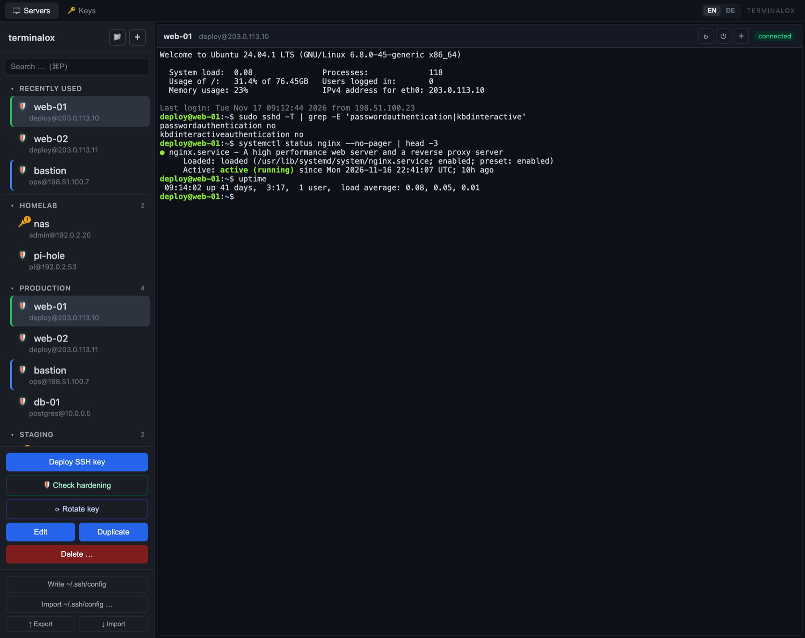
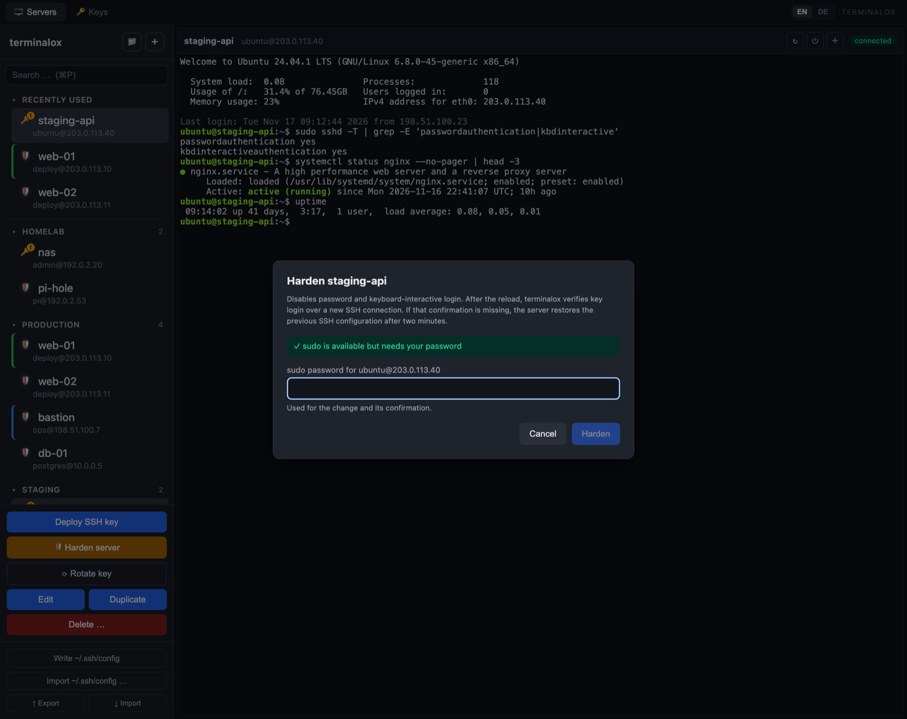
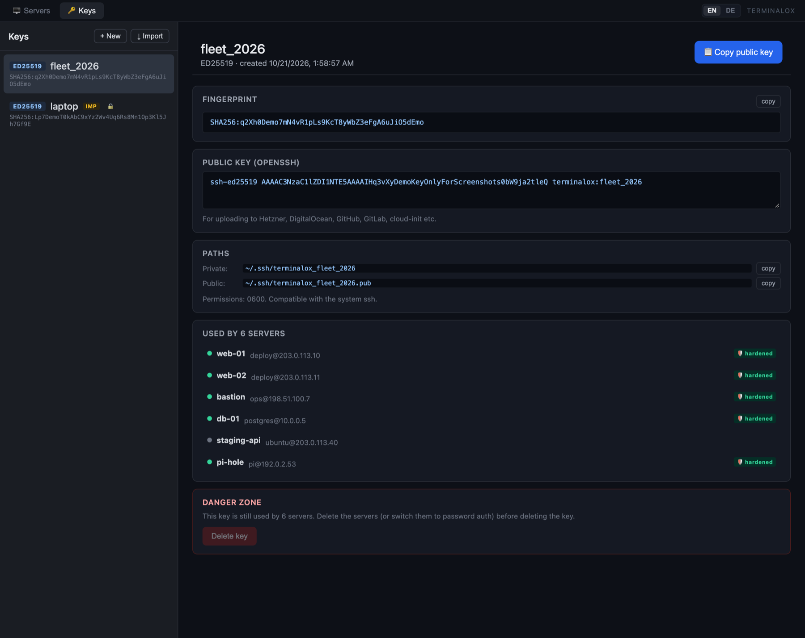
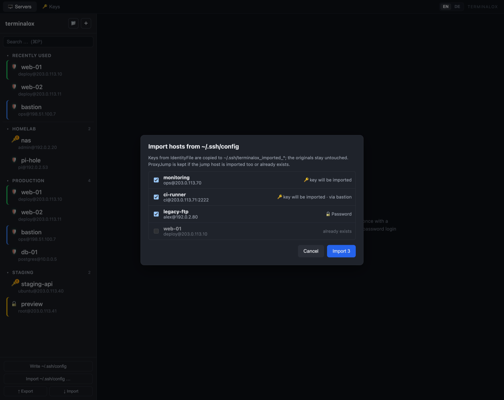
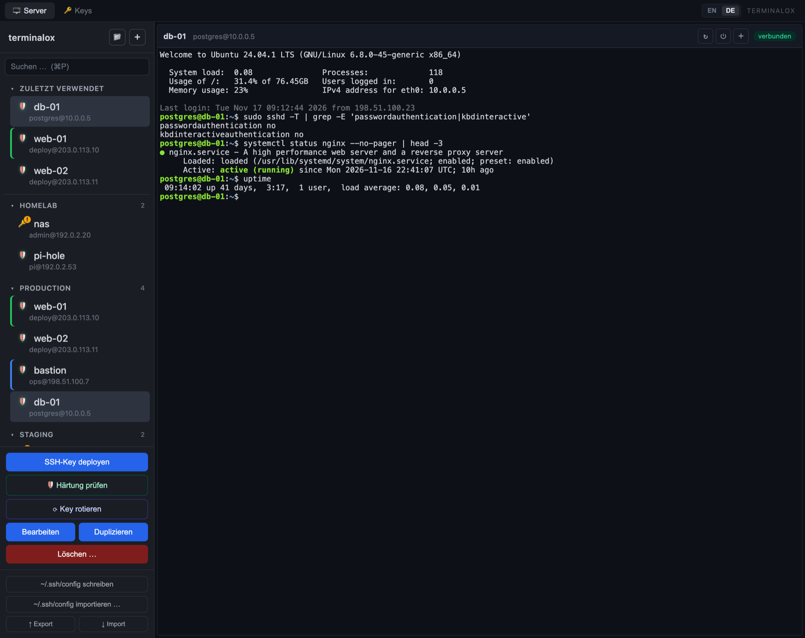

# terminalox

[](https://github.com/IDGUX/terminalox/actions/workflows/ci.yml)

> **Disclaimer.** terminalox is an experimental open-source side project provided
> **AS-IS** and is **not developed in the course of a commercial activity**. It is
> **not intended for production use**. It is published as **source code only**;
> you build and run it yourself. Use entirely at your own risk; **no warranty**,
> **no fitness-for-purpose claim**, and **no liability** is accepted to the extent
> permitted by law. See [LICENSE](LICENSE) for the full MIT terms.

A small cross-platform SSH terminal with **one-click server hardening**.

**→ [Build it yourself](#build-it-yourself)** (macOS, Windows, Linux)



<table>
  <tr>
    <td></td>
    <td></td>
  </tr>
  <tr>
    <td align="center"><sub>One-click hardening, guarded by an automatic rollback</sub></td>
    <td align="center"><sub>Key management: fingerprint, public key, which servers use it</sub></td>
  </tr>
  <tr>
    <td></td>
    <td></td>
  </tr>
  <tr>
    <td align="center"><sub>Import existing hosts from <code>~/.ssh/config</code></sub></td>
    <td align="center"><sub>English and German UI</sub></td>
  </tr>
</table>

<sub>Screenshots use made-up demo data. To reproduce them: <code>pnpm dev</code> and open <code>http://localhost:1420/?demo</code> (see <code>src/lib/demo.ts</code>).</sub>

The use case this was built for: you SSH into a lot of boxes every day, but setting up SSH keys per server is enough friction that you end up typing passwords. terminalox fixes that — add a server once, click **Deploy + harden**, and the app:

1. generates an Ed25519 keypair,
2. pushes the public key into `~/.ssh/authorized_keys` on the server,
3. verifies key-auth actually works,
4. installs `/etc/ssh/sshd_config.d/00-terminalox.conf` to disable password and keyboard-interactive authentication,
5. validates `sshd -t` + reloads sshd,
6. opens a fresh SSH connection, verifies key login again and confirms that both password methods are disabled for that connection.

Hardening needs root or `sudo`, `bash` and `flock` on the server, and a running SSH service that can be reloaded through systemd, OpenRC or `service`. Before editing the SSH configuration, terminalox saves the affected files and schedules a server-side rollback after two minutes: a transient systemd timer where available, otherwise a detached background process started with `setsid`. If a step on the server fails, terminalox restores the previous configuration immediately. It cancels the rollback and marks the server 🛡 *hardened* after the fresh connection passes verification. If the client disconnects or verification fails, the timer restores the previous configuration and reloads SSH. Minimal images such as Alpine may need `apk add bash` first; the hardening dialog names any missing tool.

## Remove a server entry

- **Server already decommissioned** — Uncheck **Also remove the SSH key from the server** in the delete dialog. To also remove the associated key files from your computer, select **Delete the associated private SSH key locally**. This works without an SSH connection. If another server entry uses the key, terminalox keeps it.
- **Server still reachable** — Keep **Also remove the SSH key from the server** selected to remove the public key from the server. terminalox makes sure you keep a way in:
  - **With a password:** If the entry is marked as hardened, terminalox first undoes its SSH configuration changes. It then requires a successful password login over a fresh SSH connection before removing the public key. If that login fails, terminalox re-applies the hardening and keeps the key.
  - **Without a password** (key-only accounts, typical for cloud servers): Leave the password empty and confirm **No password: I have another SSH key for this account**. terminalox removes the key over the key itself and refuses if no other key would remain in `authorized_keys`. The hardening stays in place.

  If remote cleanup fails, you can retry or choose **Delete locally only** to remove the entry and keep the local key.

You can remove unused keys from previously deleted server entries in the key management view.

## Features

- English (US) and German UI, following the system language (switch with EN | DE in the tab bar).
- Interactive SSH terminal with tabs and split panes (xterm.js, full PTY, binary IPC channel).
- SSH host-key verification using `~/.ssh/known_hosts`, with a fingerprint prompt for new keys.
- Ed25519 key generation (optionally passphrase-protected) + import of existing keys, including encrypted ones.
- Login via password, terminalox key or the running **ssh-agent** (OpenSSH agent, 1Password, Pageant …).
- **Jump hosts** (like `ProxyJump`): any server entry can tunnel through another one, also for deploy, hardening and cleanup.
- Passwords and key passphrases are asked once and can optionally be stored in the OS keychain (macOS Keychain, Windows Credential Manager, Secret Service).
- **One-click SSH hardening** and optional removal of the managed configuration during server cleanup.
- **Key rotation**: new key is added and verified before the old one is revoked, so access is never lost.
- Key management page with fingerprint, copy-public-to-clipboard, reverse-lookup ("which servers use this key").
- Managed block in `~/.ssh/config` so the system `ssh` command works alongside the app (unique aliases, `ProxyJump`); existing hosts can be **imported from `~/.ssh/config`**.
- Encrypted backup/restore (AES-256-GCM + Argon2id) for moving state between machines. Imported entries are validated like manual input.
- Pure Rust SSH stack (russh) — no OpenSSL dependency.
- Minimal Tauri 2 capabilities: only `core`, `clipboard-manager:write-text`, `dialog:open/save` and `opener:open-url` restricted to `http(s)` links; strict Content Security Policy.

## Build it yourself

terminalox is published as **source code only**. There are no prebuilt installers: you build the app on your own machine from the code in this repository. A first build takes about 5–15 minutes; later builds are much faster.

A self-built app is not downloaded from the internet, so macOS Gatekeeper and Windows SmartScreen do not complain about a missing code signature.

### macOS

```bash
# 1. Tools: Xcode Command Line Tools, Rust, Node.js, pnpm
xcode-select --install
curl --proto '=https' --tlsv1.2 -sSf https://sh.rustup.rs | sh -s -- -y
source "$HOME/.cargo/env"
brew install node            # or the LTS installer from https://nodejs.org
npm install -g pnpm@10

# 2. Build
git clone https://github.com/IDGUX/terminalox.git
cd terminalox
pnpm install --frozen-lockfile
pnpm tauri build

# 3. Install
cp -R src-tauri/target/release/bundle/macos/terminalox.app /Applications/
```

#### Local network access (servers on your LAN)

On first connect to a host in your local network (e.g. a Raspberry Pi), macOS asks whether terminalox may access the local network. If you deny it, or the permission gets lost, connections to LAN hosts fail with `No route to host`, while `ssh` from Terminal still works (Terminal has its own permission). Re-enable it under **System Settings → Privacy & Security → Local Network**.

macOS ties this permission to the app's code signature. A default self-built app is only ad-hoc signed, and every rebuild gets a new signature, so **the permission is lost after each update**. To keep it across builds, sign with a stable local certificate (one-time setup):

1. Open **Keychain Access → Keychain Access (menu) → Certificate Assistant → Create a Certificate…**
2. Name: `terminalox Local`, Identity Type: **Self-Signed Root**, Certificate Type: **Code Signing** → Create.
3. Build with that identity:

   ```bash
   APPLE_SIGNING_IDENTITY="terminalox Local" pnpm tauri build
   ```

   On the first build, macOS asks whether `codesign` may use the key; choose **Always Allow**.

After installing that build and allowing local network access once, the permission survives all later builds signed the same way. `security find-identity -p codesigning` lists the certificate as `CSSMERR_TP_NOT_TRUSTED`; that is expected for a self-signed certificate and does not affect local signing. The certificate stays in your keychain and is never part of the repository.

### Windows (PowerShell)

Open **PowerShell** (no admin needed for most steps; the Build Tools installer asks for elevation itself):

```powershell
# 1. Tools: Git, Rust, Node.js, C++ Build Tools, WebView2
winget install --id Git.Git -e
winget install --id Rustlang.Rustup -e
winget install --id OpenJS.NodeJS.LTS -e
winget install --id Microsoft.VisualStudio.2022.BuildTools -e --override "--passive --wait --add Microsoft.VisualStudio.Workload.VCTools --includeRecommended"
winget install --id Microsoft.EdgeWebView2Runtime -e   # already included in Windows 11
```

**Close and reopen PowerShell** so the new tools are on `PATH`, then:

```powershell
# 2. Allow npm/pnpm scripts for your user (only needed once)
Set-ExecutionPolicy -Scope CurrentUser RemoteSigned

# 3. pnpm + build
rustup default stable
npm install -g pnpm@10
git clone https://github.com/IDGUX/terminalox.git
cd terminalox
pnpm install --frozen-lockfile
pnpm tauri build

# 4. Install: run the generated setup
Get-ChildItem src-tauri\target\release\bundle\nsis\*-setup.exe | ForEach-Object { Start-Process $_.FullName }
```

The build also produces an `.msi` in `src-tauri\target\release\bundle\msi\`.

### Linux (Debian / Ubuntu)

```bash
# 1. Tools: system libraries, Rust, Node.js 22, pnpm
sudo apt update
sudo apt install -y git curl build-essential pkg-config libssl-dev libdbus-1-dev \
  libwebkit2gtk-4.1-dev libayatana-appindicator3-dev librsvg2-dev
curl --proto '=https' --tlsv1.2 -sSf https://sh.rustup.rs | sh -s -- -y
source "$HOME/.cargo/env"
curl -fsSL https://deb.nodesource.com/setup_22.x | sudo -E bash -
sudo apt install -y nodejs
sudo npm install -g pnpm@10

# 2. Build
git clone https://github.com/IDGUX/terminalox.git
cd terminalox
pnpm install --frozen-lockfile
pnpm tauri build

# 3. Install the .deb (or run the AppImage from bundle/appimage/)
sudo apt install ./src-tauri/target/release/bundle/deb/*.deb
```

Other distributions need the equivalent packages; see the [Tauri prerequisites](https://v2.tauri.app/start/prerequisites/).

### Update to a newer version

```bash
cd terminalox
git pull
pnpm install --frozen-lockfile
pnpm tauri build
```

Then install the new build the same way as above. Your servers and keys are kept. On macOS, build with `APPLE_SIGNING_IDENTITY` if you set up a local certificate, otherwise local network access must be allowed again after each update (see [Local network access](#local-network-access-servers-on-your-lan)).

If `cargo` is not found in a new terminal window, run `source "$HOME/.cargo/env"` first.

### Development

```bash
pnpm tauri dev          # app with hot-reload
```

Universal macOS binary (Apple Silicon + Intel):

```bash
rustup target add x86_64-apple-darwin
pnpm tauri build --target universal-apple-darwin
```

## Project layout

```
src/                    Svelte 5 frontend (SvelteKit + adapter-static, SPA mode)
  lib/
    api.ts              Typed IPC wrappers
    stores/             Reactive app + toast stores
    components/         All UI components
  routes/+page.svelte   Main layout
src-tauri/
  src/
    lib.rs              Tauri builder + command registration
    commands/           All Tauri commands (servers, keys, session, harden, backup)
    ssh/                russh wrappers (client, deploy, revoke, harden, session)
    ssh_config.rs       ~/.ssh/config managed-block writer
    keygen.rs           Ed25519 generation / import
    models.rs           Server, KeyInfo, AuthMode
    storage.rs          JSON persistence in app data dir
  capabilities/         Tauri capability lockdown
  tauri.conf.json       App metadata
```

## Development checks

Run `pnpm check` for frontend diagnostics, `pnpm build` for the static frontend build, and `cargo check --locked --all-targets` from `src-tauri/` to check the Rust targets. GitHub Actions also tests key revocation and the timed rollback (systemd timer and `setsid` fallback) against OpenSSH on Linux.

## Security notes

- **Try hardening on a test server first**, and keep a second SSH session open while you harden a server you depend on.
- Passwords and key passphrases are kept in memory only, unless you tick **Remember** in the prompt; then they are stored in the OS keychain (macOS Keychain, Windows Credential Manager, Secret Service), never in terminalox's own files. terminalox uses passwords for SSH login during deployment and cleanup, or for `sudo` when changing the server configuration.
- Managed private keys are files under `~/.ssh/terminalox_*`, optionally protected with a passphrase. On Unix, terminalox creates them with mode `0600`. On Windows, the files inherit filesystem permissions.
- terminalox checks `~/.ssh/known_hosts` before sending credentials. For a new key, compare the displayed SHA-256 fingerprint with a fingerprint obtained through a trusted channel before accepting it. A changed key of the same algorithm triggers a warning. Approving a replacement appends it to `known_hosts`; retire the old key separately once you have verified the rotation. An unreadable trust store can be treated as empty, and the parser does not honor OpenSSH `@revoked` markers.
- Host verification uses public host keys. OpenSSH host certificates and certificate authority entries are currently unsupported.
- SSH hardening installs `/etc/ssh/sshd_config.d/00-terminalox.conf` and may add a managed `Include` block to `/etc/ssh/sshd_config`. Uninstalling terminalox leaves the remote configuration in place.
- Hardening changes a daemon-wide SSH configuration. Verification evaluates `Match` rules for the tested SSH user and connection. Other users or source addresses can have different settings. Keep a separate recovery channel available. The rollback timer (transient systemd timer or detached `setsid` process) survives an SSH disconnect; a server reboot or a failed service reload may require manual recovery. Pending rollback files are stored in `/etc/ssh/.terminalox-pending`.
- Backups protected by a passphrase use AES-256-GCM with Argon2id (64 MiB, 3 iterations, 4 lanes). Plain JSON backups contain private keys in base64. Set a passphrase to protect exported keys.

## Roadmap

- SFTP panel.
- Port-forwarding.

## License

MIT — see [LICENSE](LICENSE).
